<div align="center">



# KittyTune Website

**The official website of [KittyTune](https://github.com/alan7383/kittytune), the free and open-source music player built around SoundCloud.**

Written entirely in Kotlin with Compose Multiplatform for the web (Kotlin/Wasm) and Material 3 Expressive.

[**Visit the site**](https://alan7383.github.io/kittytune-website/) ·
[Android app](https://github.com/alan7383/kittytune) ·
[Desktop app](https://github.com/alan7383/KittyTuneDesktop) ·
[Support on Ko-fi](https://ko-fi.com/alan7383)

</div>

---

## What's inside

Nothing on this site is a screenshot pretending to be interactive. Every card is a small piece of KittyTune rebuilt in Compose, and you can play with it right in the browser.

| Page | What you'll find |
| :--- | :--- |
| **Home** | Live demos: karaoke lyrics over the desktop app's fluid artwork background, audio effects, stem isolation, Listen Together, Shazam, dynamic color, the Kitty Pet, offline downloads, phone ⇄ desktop handoff and more |
| **Features** | Ten chapters (player, lyrics, sound, SoundCloud, discover, library, together, style, fun, system), each with an interactive demo |
| **Together** | The web invite page for Listen Together rooms, with an end-to-end encrypted relay |
| **Download** | Every platform in one place: Android APKs, Windows, macOS (Apple Silicon and Intel), Linux (AppImage, .deb, .rpm, AUR, Nix flake) and the latest release notes from GitHub |

### Highlights

- **Material 3 Expressive everywhere**: morphing shapes, connected button groups, wavy progress indicators, spring motion and the real `LoadingIndicator` (also drawn by the HTML splash before the app has even downloaded).
- **Material You theming**: pick a seed color, a palette style and light or dark mode, and the whole site re-themes with a circular reveal.
- **Real lyrics engine**: a web port of KittyTune Desktop's karaoke renderer, fed with live synced lyrics from [LRCLIB](https://lrclib.net) at runtime.
- **Fluid artwork background**: the same SkSL shader as the desktop full-screen player (Apple Music style), running on Skia in the browser.
- **8 languages**: English, French, German, Hungarian, Brazilian Portuguese, Russian, Turkish and Vietnamese.
- **Linux first, unblockable**: sections about Linux support and about using KittyTune where SoundCloud is blocked (Zapret DPI bypass and HTTP/SOCKS5 proxy).

## Tech stack

- [Kotlin](https://kotlinlang.org) 2.4 targeting **WebAssembly** (`wasmJs`)
- [Compose Multiplatform](https://www.jetbrains.com/compose-multiplatform/) 1.12 with **Material 3** (expressive APIs)
- [MaterialKolor](https://github.com/jordond/MaterialKolor) for dynamic color schemes
- [Compottie](https://github.com/alexzhirkevich/compottie) for Lottie animations
- Google Sans Flex (variable) with Nunito as the Cyrillic fallback

## Getting started

Requirements: **JDK 17+**. Gradle and Node are downloaded automatically by the wrapper.

```bash
git clone https://github.com/alan7383/kittytune-website.git
cd kittytune-website

# Dev server with live reload (http://localhost:8080)
./gradlew wasmJsBrowserDevelopmentRun

# Production build, output in build/dist/wasmJs/productionExecutable
./gradlew wasmJsBrowserDistribution
```

Any modern browser with WebAssembly GC support works (Chrome / Edge 119+, Firefox 120+, Safari 18.2+).

## Project structure

```
src/wasmJsMain/
├── kotlin/
│   ├── Main.kt                  Entry point (mounts Compose into #kt-root)
│   ├── theme/Theme.kt           Material You theme, fonts, cached color schemes
│   └── ui/
│       ├── App.kt               Navigation, top bar, theme and language panels, reveal transition
│       ├── HomePage.kt          Home page (lazy sections)
│       ├── FeaturesPage.kt      Features page with sticky chapter bar
│       ├── DownloadPage.kt      Downloads and changelog (GitHub Releases API)
│       ├── ListenAlongPage.kt   Together invite page
│       ├── TogetherWebRelay.kt  Encrypted relay client
│       ├── WebStrings*.kt       Localized copy, one file per language
│       ├── demos/               Interactive demos (player, lyrics, audio FX, globe, ...)
│       ├── kit/                 Shared components: shapes, motion, layout helpers
│       ├── lyrics/              Karaoke engine and live lyrics loader
│       └── pet/                 Kitty Pet sprite animations
├── composeResources/            Images, fonts, SVG logos, Lottie files
└── resources/index.html         HTML shell, splash loader, SEO metadata
tools/perf/                      Frame-time benchmark (see below)
```

## Performance

The site is meant to feel as smooth as the apps. A headless Chromium benchmark measures frame times during load, idle, normal and very fast tab switching, and color changes, and can print a CPU profile per scenario:

```bash
./gradlew wasmJsBrowserDevelopmentExecutableDistribution
python3 tools/perf/serve.py build/dist/wasmJs/developmentExecutable &
pip install playwright && playwright install chromium
python3 tools/perf/bench.py /tmp/bench --profile
```

A few rules the code follows because of it:

- Pages are `LazyColumn`s, so only what is on screen is composed and measured.
- Animations read their clocks in the draw phase (`drawBehind`, `graphicsLayer`), never in composition.
- Expensive objects (shape morphs, color schemes, fonts) are built once and cached.
- Theme changes swap the palette in one go behind a snapshot instead of animating every color.

## Deployment

Every push to `master` builds the production bundle and publishes it to GitHub Pages through [`.github/workflows/deploy.yml`](.github/workflows/deploy.yml).

## Contributing

Issues and pull requests are welcome. For bugs in the apps themselves, please use the [Android](https://github.com/alan7383/kittytune/issues) or [Desktop](https://github.com/alan7383/KittyTuneDesktop/issues) repositories.

Translations live in `src/wasmJsMain/kotlin/ui/WebStrings*.kt`: copy the English defaults from `WebStringsSite.kt` and override what you translate.

## Credits

- Album artwork shown in the demos belongs to the respective artists on SoundCloud.
- Synced lyrics are fetched live from [LRCLIB](https://lrclib.net) and are not stored in this repository.
- Nunito is licensed under the SIL Open Font License (see `composeResources/font/NUNITO_OFL_LICENSE`).

## License

MIT © alan7383
